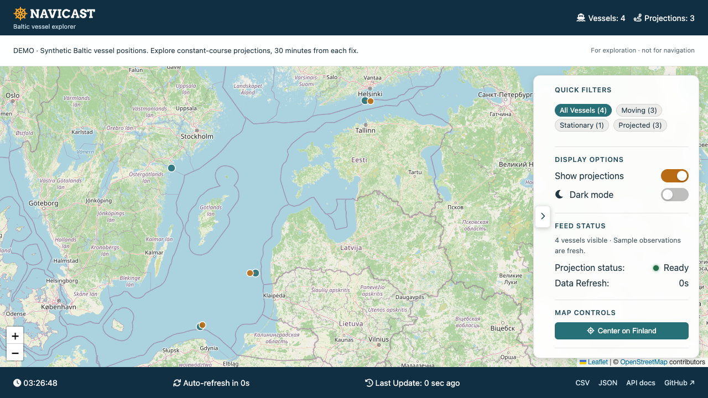

# NaviCast

> **Maintenance mode:** no further development. The Cloudflare Worker keeps serving the live map; the AIS archive crons are disabled (they exceeded the free-tier CPU limit). Existing archived data stays in D1.

NaviCast is a FastAPI and Leaflet vessel map with a live AIS pipeline and a local demo. The demo serves four synthetic Baltic vessel records and 30-minute dead-reckoning estimates. It does not need a database, AIS feed, or trained model.



## Public live map

The hosted application is deployed at <https://navicast.imadlab.com> using Cloudflare Workers. It serves this dashboard and reads current Digitraffic AIS REST snapshots, cached for 30 seconds per Cloudflare location. Vessel timestamps always refer to the original AIS observation; the browser flags stale observations. Forecasts remain constant-course estimates.

The public gateway stores no vessel history and uses no database credentials. The optional MQTT/PostgreSQL pipeline below remains available for local collection and research.

To develop or redeploy the hosted gateway:

```bash
npm ci
npm test
npm run check:deploy
npm run dev
# After Cloudflare authentication:
npm run deploy
```

`wrangler.jsonc` contains the Worker name and custom domain. Deployment changes only `navicast.imadlab.com`; the main portfolio stays on its existing host.

## Run the demo

With Docker:

```bash
docker compose up --build
```

Open <http://localhost:8000>. The API is available at `/vessels`, `/vessels/download`, `/vessels/{id}`, `/meta`, and `/health`.

Or run with Python 3.11+:

```bash
python3 -m venv .venv
source .venv/bin/activate
pip install -r requirements.lock
NAVICAST_MODE=demo python -m uvicorn api_server:app --host 127.0.0.1 --port 8000
```

## Run the live pipeline

The live profile starts PostgreSQL, the API, the Digitraffic MQTT client, and the prediction service. Copy `.env.example` to `.env`, set a local database password, then run:

```bash
docker compose --profile live up --build postgres api mqtt predictor
```

The live API is at <http://localhost:8001> by default. Set `LIVE_PORT` to change its host port. For local live mode, initialize your PostgreSQL database with `schema.sql`, set `NAVICAST_MODE=live` and the matching database settings in `.env`, then run `./start_navicast.sh`. The launcher loads the local shell configuration and checks the database before starting services.

The demo is the default Compose service. The live command above names the live services explicitly. The example database password is for local development only.

## Verify

```bash
pip install -r requirements-dev.txt
python -m pytest
node --test tests/frontend.test.cjs
```

For a running demo, `GET /meta` should report `mode: demo` and `prediction_method: dead_reckoning`; `GET /vessels` returns four records marked `data_source: synthetic`. In live mode, `/health` checks the database connection.

## Known limitations

- Demo positions and speeds are synthetic. Their timestamps are generated relative to the current time.
- Predictions are straight-line dead-reckoning estimates for 30 minutes. They are illustrative and must not be used for navigation or safety decisions.
- No trained model is served. The Worker flags projections whose straight line crosses land (`projection_land_conflict`, `projection_clear_until_fraction`) using an OpenStreetMap-derived land mask; the flag is `null` when it cannot be resolved (start on land, or outside the mask area 9–31°E, 53.5–66°N). The mask is approximate (100 m path sampling, inland lakes count as land, small islets can be absent) and the projection itself is never changed; not for navigation.
- The public Worker API has no authentication. Keep the optional local live API and database on a trusted network.
- The map uses external Leaflet, icon, and tile services, so full map rendering needs browser network access.
- `archive/ML_Model.ipynb` and `archive/ML_Model_docs/` contain historical research artifacts. They are not part of serving, and their evaluation is invalid because it used held-out target positions and a random row split.

## Data and retention

The public Worker reads Digitraffic AIS snapshots and temporarily caches them; it does not retain vessel history. Observations include MMSI, positions, source timestamps, speed, course, heading and navigation status. The optional local MQTT/PostgreSQL pipeline stores raw source messages, deletes raw rows after 24 hours and deletes stored predictions after one hour. Its in-memory ingestion buffer can lose observations during an outage or process exit.

The archive collector in [PR #30](https://github.com/imaddde867/NaviCast/pull/30) is not deployed. The proposed private archive will retain per-minute navigation observations and daily vessel metadata without automatic deletion, with offline compaction and a local backup. Storage selection, backup/offload and raw-archive removal procedures remain owner decisions in [#8](https://github.com/imaddde867/NaviCast/issues/8) and [#13](https://github.com/imaddde867/NaviCast/issues/13).

Vessel identifiers can identify people for some craft. Whether leisure craft appear in this feed is unverified. Vessel names, call signs and destinations must not appear in committed fixtures or published screenshots unless necessary and documented. The baseline fixture uses stable pseudonyms in place of MMSI and contains only fields needed by its check scripts.

The removal-request contact route and the policy for exclusion/deletion from published data, derived data and private archives await owner approval in [#7](https://github.com/imaddde867/NaviCast/issues/7). [The proposed manual removal process](docs/data_management_plan.md#proposed-removal-process--owner-approval-and-implementation-pending) uses a private owner-selected email address, a private exclusion register and explicit treatment of backups. It awaits approval and implementation.

## Data licences

Source: [Fintraffic / digitraffic.fi](https://www.digitraffic.fi/en/marine-traffic/), license [CC BY 4.0](https://creativecommons.org/licenses/by/4.0/), following [Digitraffic's attribution terms](https://www.digitraffic.fi/en/terms-of-service/). NaviCast filters and normalizes observations and adds constant-course estimates. The committed `scripts/baseline/vessels_*.json` fixture derives from this source; its identifiers are pseudonymized and unused fields removed. Estimates and upstream data have no guarantee of accuracy and must not be used for navigation.

Map tiles credit OpenStreetMap contributors. The OSM-derived land mask `cloudflare/land_mask.json` is licensed ODbL 1.0, separately from this repository's MIT code licence; see `cloudflare/LAND_MASK_NOTICE.md`, and the map footer credits OpenStreetMap and the ODbL. No IEEE DataPort or DMA dataset is committed; their licence/access checks remain open in [#15](https://github.com/imaddde867/NaviCast/issues/15).

Database integration checks use `NAVICAST_TEST_DSN` pointing to a disposable PostgreSQL instance and apply the real `schema.sql` in isolated test schemas. CI requires them with PostgreSQL 16; skipped required cases fail the report guard. See [the complete testing guide](docs/testing.md) for unit, workerd/D1, browser, coverage, mutation and Docker checks, and [the acceptance audit](docs/testing-acceptance.md) for verified scope and remaining evidence limits.

The runtime is pinned in `requirements.lock`. Regenerate it with `uv pip compile requirements.txt --universal --python-version 3.11 -o requirements.lock` after reviewing dependency updates.

## Project files

- `docs/data_architecture.md` — demo and live data flows
- `docs/data_management_plan.md` — data fields, retention, and access limits
- `archive/README.md` — historical model exploration and invalid evaluation
- `docs/roadmap/ROADMAP.md` — shared roadmap and issue order
- `LICENSE` — MIT license
- `cloudflare/LAND_MASK_NOTICE.md` — OpenStreetMap ODbL notice for the land mask
