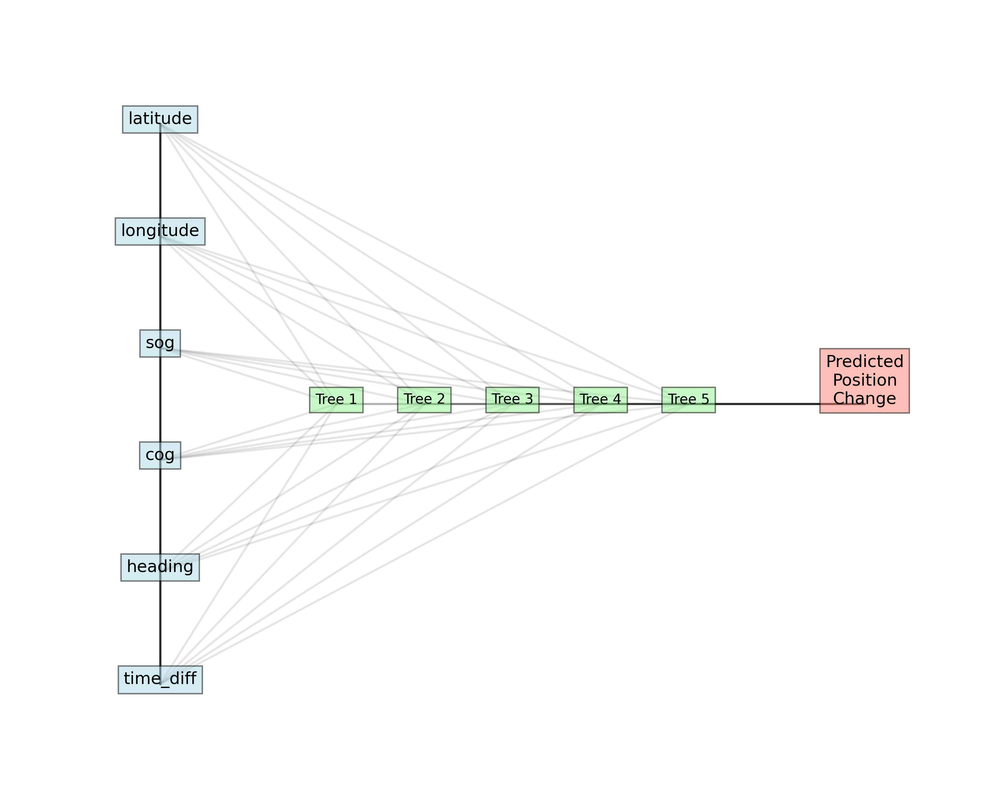
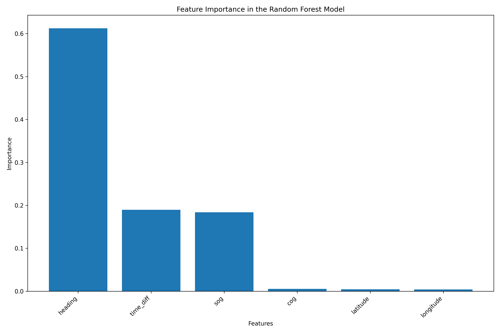
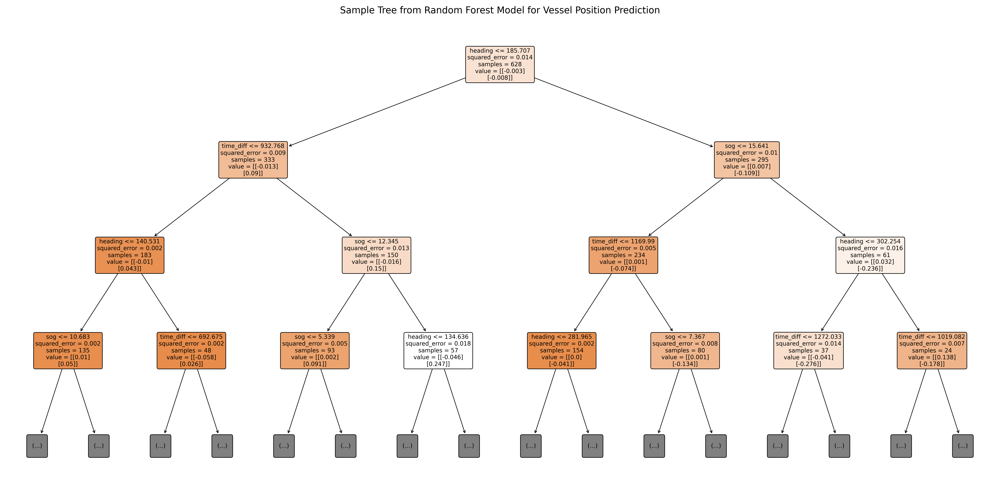
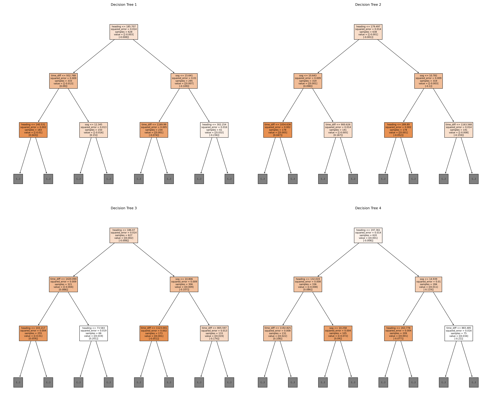
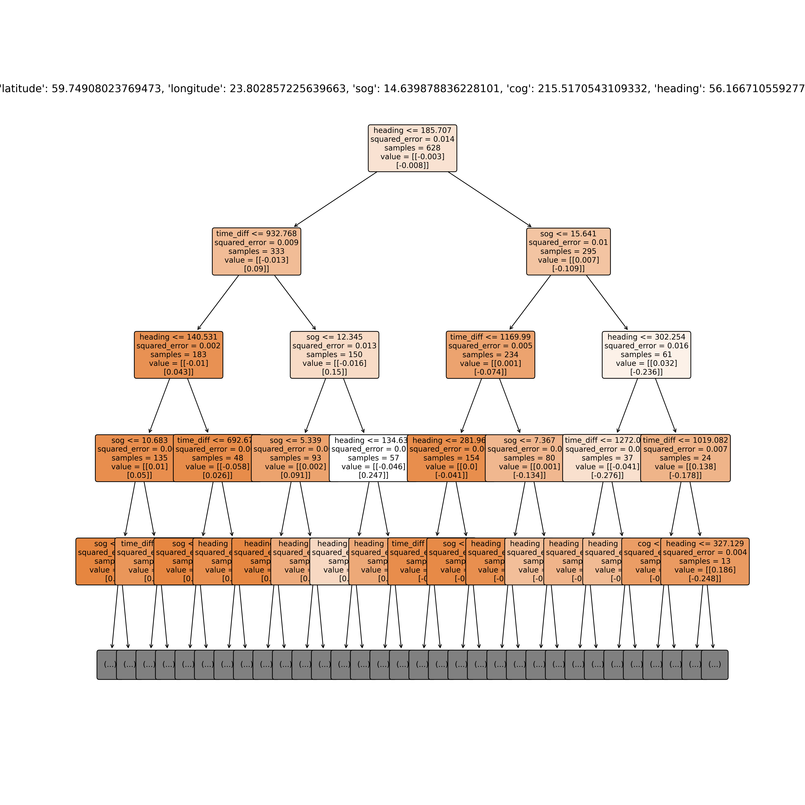

# Historical model experiment figures

These figures were generated during an earlier Random Forest exploration. They document that experiment only; its evaluation method and reported scores have not been independently validated and are not product-performance claims.

The current API does not load or serve this model. It returns straight-line dead-reckoning estimates. The archived notebook can optionally save a research artifact named `research_model.pkl`; that artifact is not compatible with or consumed by the live prediction service.

## Figures

Historical figures from the archived experiment:

